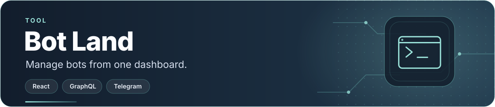

# 

A dashboard and GraphQL service for managing messaging bots. The service provisions Telegram runtimes on Railway. The WhatsApp provider directory is reserved for future work.

[Quick start](#quick-start) · [Validation](#validation) · [Project layout](#project-layout)

## Quick start

Use pnpm 8 with the original lockfiles. In each of `client/`, `service/`, and `providers/telegram/`, run `pnpm install --frozen-lockfile`.

| Component | Start command | Local settings |
|---|---|---|
| Client | `pnpm dev` | `VITE_BACKEND_SERVICE_URL` |
| Service | `pnpm build`, then `pnpm start` | `TURSO_DATABASE_URL` and `TURSO_AUTH_TOKEN` for persistence |
| Telegram | `pnpm build`, then `pnpm start` | `TELEGRAM_BOT_TOKEN` |

Railway provisioning also uses `RAILWAY_API_URL`, `RAILWAY_API_TOKEN`, `RAILWAY_PROJECT`, `RAILWAY_ENV`, and `GITHUB_REPOSITORY`. Keep credentials in local or hosted environment settings and put the GraphQL service behind access controls.

## Validation

Run `pnpm build` in all three packages. These builds work independently of a live bot deployment.

## Project layout

| Path | Purpose |
| --- | --- |
| [`client/`](client/) | Dashboard |
| [`service/`](service/) | GraphQL API and provisioning |
| [`providers/telegram/`](providers/telegram/) | Telegram runtime |
| [`providers/wa/`](providers/wa/) | WhatsApp provider placeholder |

## Project notes

Configure each Railway service with its component directory. Use `/providers/telegram` as the root for Telegram deployments.
